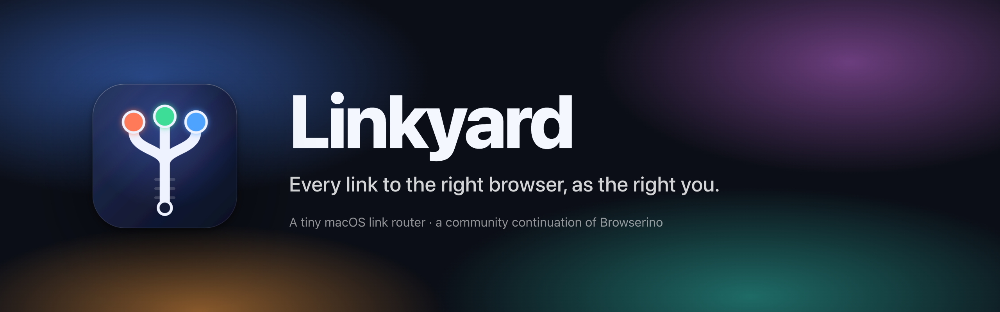
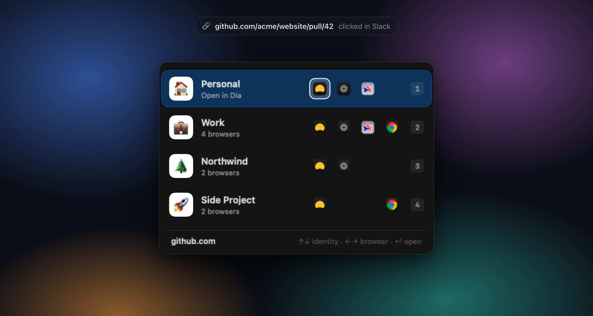
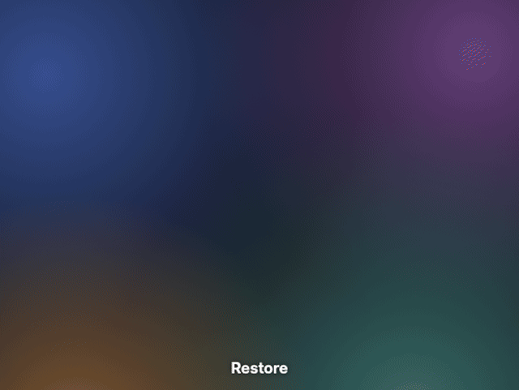
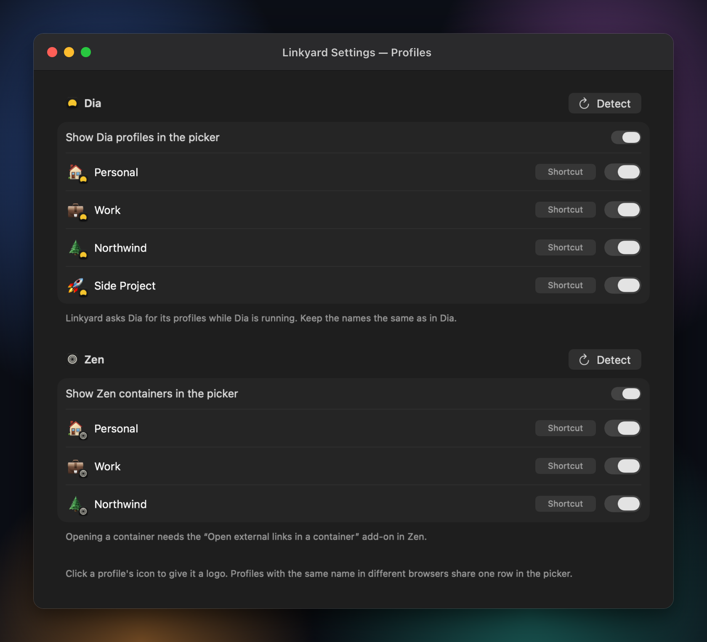
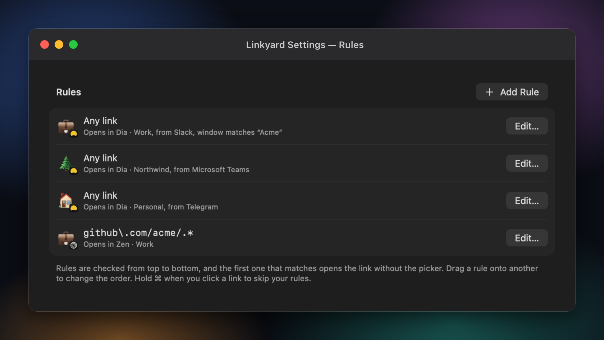

<div align="center">



<p>
  <a href="https://github.com/jravolio/linkyard/releases/latest"></a>
  <a href="https://github.com/jravolio/linkyard/actions/workflows/ci.yml"></a>
  <a href="LICENSE"></a>
  
  
  <a href="#-ai-disclosure"></a>
  <a href="https://github.com/AlexStrNik/Browserino"></a>
</p>

<p><a href="#-features">Features</a> · <a href="#-install">Install</a> · <a href="#-set-up-profiles">Profiles</a> · <a href="#-build-from-source">Build</a> · <a href="#-faq">FAQ</a> · <a href="#-credits">Credits</a></p>

</div>

<br>

<p align="center">
  
  <br>
  <sub>The real picker, rendered from the app with demo profiles</sub>
</p>

Linkyard is a tiny link router for macOS. Make it your default browser, and every link you click in Slack, Mail, Notion or anywhere else comes to Linkyard first. Rules send it straight to the right place; otherwise a small picker asks **who you are** (Personal, Work, a client) and **which browser** to use, and the link opens in that browser's matching profile.

> [!NOTE]
> Linkyard is a community continuation of **[Browserino](https://github.com/AlexStrNik/Browserino)** by Aleksandr Strizhnev ([@AlexStrNik](https://github.com/AlexStrNik)). Browserino is the foundation of everything here, and all the credit for it goes to him and its contributors. Linkyard keeps the full project history, the same GPL-3.0 license, and adds profile support for more browsers plus a few opinions of its own. The changes are listed in [CHANGELOG.md](CHANGELOG.md).

## ✨ Features

- 🪪 **Identities, not just browsers**: the picker shows one row per identity, with each browser that has a matching profile in its own column. Press **1–9** to open an identity in its first browser.
- 🧭 **Profiles in five browsers**: Chrome profiles, Arc spaces, Dia profiles, Zen containers and Helium profiles. Any other browser (Safari, Firefox, Brave…) shows up as a plain entry.
- 🖼️ **A logo per profile**: give each profile its company's logo; the picker draws it with a small badge of the browser it opens in.
- 🚦 **Rules**: match a link by URL pattern, by the app it was clicked in, or by that app's window title (handy for telling Slack workspaces apart), and send it to a browser and profile without asking.
- 📱 **Apps**: open links for certain sites straight in their Mac app.
- ⌨️ **Keyboard first**: ↑↓ picks the identity, ←→ the browser, ↵ opens, ⇧↵ opens a private window, ⌥⌘C copies the link, Esc closes. Hold ⌘ while clicking a link to skip your rules.
- 🎯 **Opens where you look**: at the cursor or in the center of the screen, instantly or with an animation you can preview: Fade, Rise, Zoom, a Dia-style Glow, or one of seven effects, from a burn in reverse to a hologram scan.
- 🔎 **Searchable Settings**: find any setting, browser, profile, rule or app from the sidebar search.
- 🔄 **Updates itself**: Linkyard checks GitHub for a new release once a day and shows what changed; install it then, later, or let Linkyard install updates on its own. From 1.3.0 on, permissions you allowed stay allowed. **Check for Updates…** is in the menu bar.
- 🔁 **Coming from Browserino?** Linkyard imports your Browserino settings the first time it starts.

## 📸 Screenshots

<p align="center">
  <br>
  <sub>The seven picker effects in Settings → Picker, recorded from the app</sub>
</p>

<table>
  <tr>
    <td width="50%" align="center"><br><sub>Profiles, each with its own logo</sub></td>
    <td width="50%" align="center"><br><sub>Rules by link, source app or Slack workspace</sub></td>
  </tr>
</table>

## 📦 Install

Download `Linkyard-<version>.zip` from the [latest release](https://github.com/jravolio/linkyard/releases/latest), unzip it and drag **Linkyard.app** into Applications. After that, Linkyard updates itself; versions before updates were added need to be replaced by hand once.

**First launch:**

1. Linkyard isn't notarized by Apple, so macOS blocks it the first time. Open **System Settings → Privacy & Security** and click **Open Anyway**. This happens once.
2. In Linkyard's Settings → **General**, make it your default browser.
3. Allow **Accessibility** when asked. Rules that look at window titles (like Slack workspaces) need it. Settings → Permissions shows everything Linkyard needs and whether it's allowed.
4. Allow Linkyard to control **Arc** and **Dia** the first time it opens a link in them. That's how it picks the space or profile.

## 🧩 Set up profiles

Open Settings → **Profiles**. Linkyard detects your Chrome profiles, Arc spaces, Dia profiles, Zen containers and Helium profiles; rename them, hide the ones you don't use, and click the icon next to each one to give it a logo. Profiles with the same name in different browsers become one identity in the picker.

<details>
<summary><b>Dia</b></summary>

Dia doesn't accept the usual command-line flag for picking a profile, so Linkyard asks Dia through Apple Events to open the link in the profile with that name. Keep Dia's profile names the same as the ones in Linkyard.
</details>

<details>
<summary><b>Zen</b></summary>

Zen keeps each identity in a container, and Linkyard opens links in a container through a small Firefox add-on:

1. Install [Open external links in a container](https://addons.mozilla.org/firefox/addon/open-url-in-container/) in Zen.
2. In `about:config`, set `zen.workspaces.force-container-workspace` to `true`. A link opened in a container then lands in the workspace that uses that container.
3. Name the containers the way you want them to appear in Linkyard.
</details>

<details>
<summary><b>Arc, Chrome and Helium</b></summary>

Nothing to set up. Arc spaces are opened through AppleScript; Chrome and Helium profiles with Chromium's `--profile-directory` flag.
</details>

## 🔨 Build from source

You need Xcode 16 or later.

```sh
git clone https://github.com/jravolio/linkyard.git
cd linkyard
scripts/build-release.sh   # → dist/Linkyard-<version>.zip
```

Or open `Browserino.xcodeproj` and run the **Browserino** scheme. The Xcode project and target keep Browserino's names so the history and changes stay easy to compare with the original.

Releases are built by [GitHub Actions](.github/workflows/release.yml) when a `v*` tag is pushed.

## ❓ FAQ

<details>
<summary><b>Why does macOS say it can't verify Linkyard?</b></summary>

Apple only stops showing that warning for apps signed with a paid Developer ID. Linkyard is free and doesn't have one, so you approve it once in System Settings → Privacy & Security → **Open Anyway**. You can always [build it yourself](#-build-from-source) instead.
</details>

<details>
<summary><b>I used Browserino. Do I lose my setup?</b></summary>

No. The first time Linkyard starts, it copies your Browserino browsers, profiles, rules and shortcuts. Then make Linkyard the default browser, allow its permissions, and quit Browserino.
</details>

<details>
<summary><b>A rule for my Slack workspace doesn't match.</b></summary>

Window-title rules need Accessibility access. Linkyard keeps it across updates from 1.3.0 on, but macOS turns it off for a build of its own, such as one you build yourself or any version before 1.3.0. Open Settings → Permissions: if Accessibility isn't allowed, click Allow… and switch Linkyard on in System Settings.
</details>

## 🤝 Contributing

Issues and pull requests are welcome. If your change touches a browser integration, say which browser and version you tested with.

## 🤖 AI disclosure

Everything Linkyard adds on top of Browserino was written by AI. The new code, the logo and artwork, the screenshots' demo setup, the build scripts and this README were written by [Claude](https://www.anthropic.com/claude), Anthropic's model, through Claude Code, directed by a human who uses it every day and tested it on their own Mac.

Browserino itself, which Linkyard is built on, was written by Aleksandr Strizhnev and its contributors, not by AI.

## 📄 License

[GPL-3.0](LICENSE), the same as Browserino. Linkyard is a modified version of Browserino; the modifications are listed in [CHANGELOG.md](CHANGELOG.md).

## 🙏 Credits

- **[Aleksandr Strizhnev](https://github.com/AlexStrNik)**, who created [Browserino](https://github.com/AlexStrNik/Browserino). Thank you for building it and sharing it.
- Browserino contributors whose work is part of Linkyard: [@byt3m4st3r](https://github.com/byt3m4st3r) (browser search locations), [@mihado](https://github.com/mihado) (Esc to close), [@ventz](https://github.com/ventz) (app shortcuts and wildcard domains) and [@motilevy](https://github.com/motilevy) (Chrome profiles, [#48](https://github.com/AlexStrNik/Browserino/pull/48)).
- Zen support relies on [Open external links in a container](https://addons.mozilla.org/firefox/addon/open-url-in-container/).
- Updates use [Sparkle](https://sparkle-project.org) (MIT license).

<sub>Linkyard is an independent community project. It isn't affiliated with Browserino's author, The Browser Company (Arc, Dia), Google (Chrome), the Zen Browser project, imput (Helium) or Apple. Product names belong to their owners.</sub>
